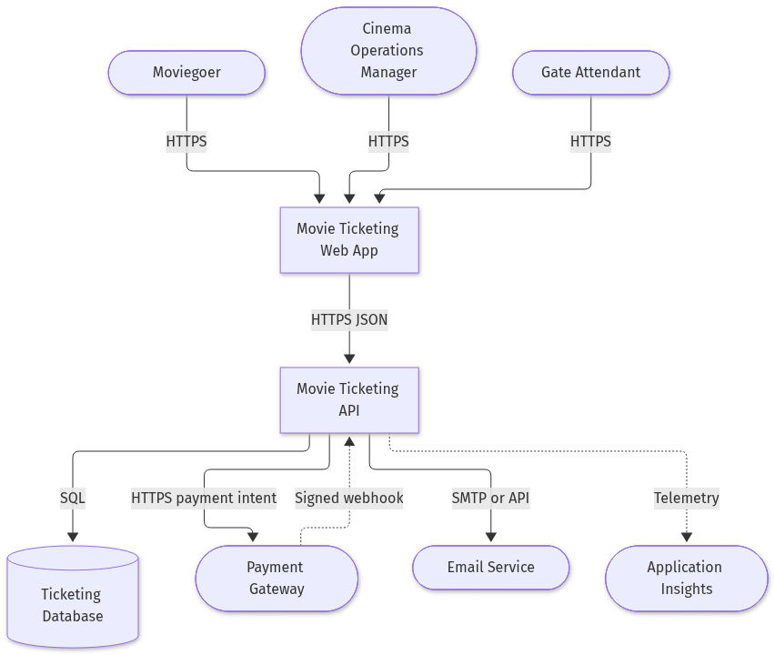
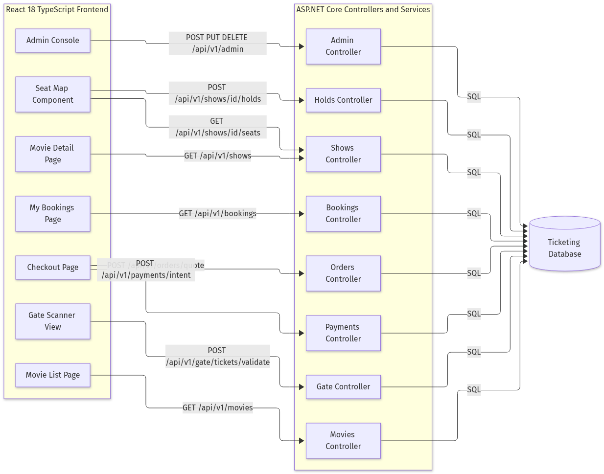
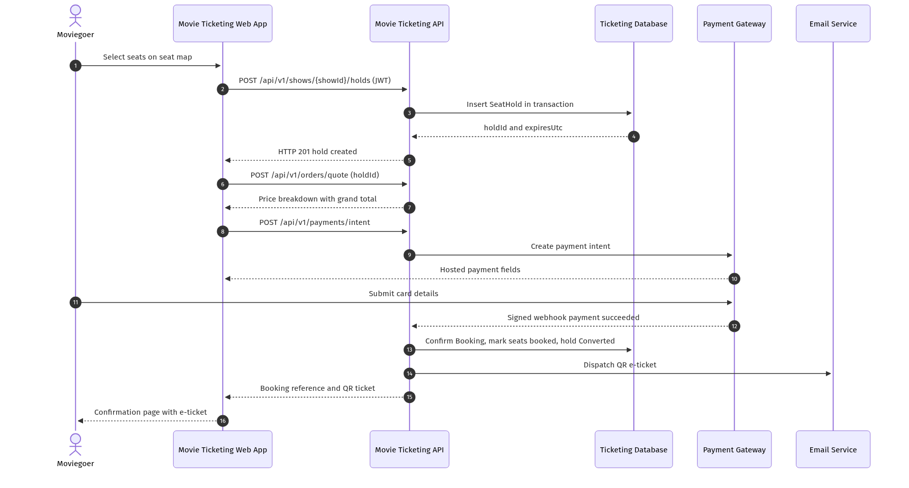

# **1. Introduction**

## **1.1 Purpose**

Moviegoers today cannot reliably reserve a specific seat for a specific screening online, and cinema operators lose revenue when seats are double-sold or when abandoned checkouts lock unsold inventory. This System Design Document defines the implementation-ready design for the Online Movie Ticketing System (Azure DevOps Epic 2687), a responsive web solution that lets customers discover movies, browse showtimes across cinemas, select seats on an interactive seat map, pay online and receive a QR-coded e-ticket, while cinema operations staff manage catalogue, scheduling and pricing and gate attendants validate tickets at entry.

## **1.2 Scope**

- **Functional Scope**: Movie discovery and showtime browsing (Feature 2688), seat selection and concurrency-safe seat-hold management (Feature 2692), checkout, payment and QR e-ticket issuance (Feature 2696), customer account, booking history and cancellation with refund initiation (Feature 2700), and cinema operations administration with gate-side ticket validation (Feature 2704).
- **Non-Functional Scope**: HTTPS-only transport, JWT bearer authentication with role-based permission checks enforced server-side, deny-by-default authorization on all administrative and gate endpoints, salted password hashing, gateway-hosted payment fields so no card data ever touches platform code, signature-verified payment webhooks, immutable audit logging with correlation IDs, and PCI-DSS SAQ-A scope reduction through hosted fields.
- **In-Scope Integrations**: Third-party payment gateway (payment intent creation plus signed webhook callback), transactional email service for e-ticket delivery, Azure Key Vault for secrets and JWT signing keys, and Application Insights plus Log Analytics for telemetry.
- **Out-of-Scope Items**: Native mobile applications, physical turnstile or barcode hardware integration, loyalty or coupon engines, food and beverage ordering, dynamic surge pricing, and third-party aggregator distribution channels.
- **Assumptions & Constraints**: The cancellation cut-off period and any cancellation penalty percentage are explicitly flagged as an open question on User Story 2703 and are modelled here as configurable platform settings rather than hard-coded values. Seat-hold duration and maximum seats per transaction are likewise configuration-driven. The payment gateway is assumed to support hosted payment fields, idempotent webhooks keyed on `gatewayReference`, and server-to-server refunds. Measurable availability and latency targets were not supplied by the requester; the values stated in Section 4.3 are architecture assumptions requiring business confirmation.

## **1.3 Methodology**

Delivery follows an Agile Scrum cadence with two-week sprints, with requirements traced from Epic 2687 through five Features and seventeen User Stories, each carrying Given/When/Then acceptance criteria that act directly as design verification points. Design review proceeds in three gates: architecture review of this document, API contract review before backend implementation, and a security design review before the first production deployment. Significant choices (service-oriented monolith over microservices, database-enforced seat uniqueness, hosted payment fields) are recorded as Architecture Decision Records in `docs/architecture/epic-2687/`. Tooling comprises Azure DevOps for work-item traceability, GitHub for version-controlled architecture and code artifacts, Mermaid rendered to PNG for all diagrams, and GitHub Actions for build and deployment automation.

# **2. System Architecture**

## **2.1 Software Architecture**

The solution is a layered, service-oriented monolith deployed as containers. A monolith is chosen deliberately over microservices because the seat-hold and booking workflow requires a single transactional boundary: the guarantee that a seat is never double-sold is enforced by a database unique constraint on `(showId, seatId)` across active holds and confirmed bookings, which is far cheaper and safer to maintain inside one transactional store than across distributed services with compensating transactions.

The presentation layer is a React 18 TypeScript single-page application that renders the catalogue, the SVG/grid seat map with live seat status, the checkout summary, the account area, the role-gated admin console and the camera-based gate scanner view. It holds the access token in memory and refreshes it through an httpOnly cookie, never persisting the token in local storage.

The application layer is a .NET 8 ASP.NET Core Web API exposing versioned `/api/v1` endpoints. Authentication and RBAC middleware validates issuer, audience, expiry and signature on every protected call before dispatching to CatalogueService, SeatHoldService, PricingService, PaymentService, BookingService, TicketService and IdentityService. A hosted background worker (HoldExpiryWorker) scans for `SeatHold` rows whose `status` is `Active` and whose `expiresUtc` has passed, transitions them to `Expired` and returns their seats to sale, writing an audit entry with a correlation ID for each release.

The data layer is a relational store holding the JSON-shaped entities Movie, Cinema, Screen, Show, ShowPricing, Seat, SeatHold, Booking, Payment, Ticket, Refund, User and AuditLog. Integration with the payment gateway is outbound HTTPS for intent creation and inbound signature-verified webhooks for settlement; e-tickets are dispatched through the transactional email service, and a failed dispatch never reverses a Confirmed booking.

- !Solution Architecture

*Caption: The high-level solution architecture shows how customer, operations and gate traffic funnels through one authentication and RBAC boundary into discrete backend services sharing a single transactional database, with the payment gateway and email service as the only external dependencies in the booking critical path.*

**Fallback**: If the image cannot be rendered, the Mermaid source is version-controlled at `docs/architecture/epic-2687/high-level-solution-architecture.mmd`. Textually: React web app to JWT/RBAC middleware to {Catalogue, SeatHold, Pricing, Payment, Ticket, Booking} services to Ticketing Database; PaymentService to Payment Gateway; TicketService to Email Service; HoldExpiryWorker to Ticketing Database.

### System Context

*Caption: Three human actors (Moviegoer, Cinema Operations Manager, Gate Attendant) interact over HTTPS with the web app, which calls the API; the API integrates with the payment gateway, the email service and the observability platform.*

### Component View

*Caption: Frontend pages map one-to-one onto API controllers and the documented endpoints from the user stories, including `GET /api/v1/movies`, `POST /api/v1/shows/{showId}/holds`, `POST /api/v1/orders/quote`, `POST /api/v1/payments/intent` and `POST /api/v1/gate/tickets/validate`.*

### Data Model

*Caption: The entity-relationship model carries every field named in the acceptance criteria, including `SeatHold.expiresUtc`, `Booking.bookingReference`, `Payment.gatewayReference`, `Ticket.qrPayload` and `Refund.status`.*

### Security and RBAC

*Caption: Anonymous access is limited to catalogue and showtime reads; all other endpoints deny by default and additionally verify resource ownership against the `userId` claim in the JWT.*

# **3. Detailed Design**

## **3.1 Software Detailed Design**

**Module breakdown.** `CatalogueService` serves paged movie listings, case-insensitive partial title search with exact genre and language matching, and showtime queries that exclude shows whose `startUtc` is in the past. `SeatHoldService` creates holds inside a database transaction protected by the unique constraint on `(showId, seatId)`; the loser of a concurrent race receives HTTP 409 with a `seat-unavailable` error code while exactly one caller receives HTTP 201 with `holdId` and `expiresUtc`. `PricingService` computes the order quote as one line item per held seat plus subtotal, convenience fee and tax, guaranteeing `grandTotal = subtotal + convenienceFee + taxAmount`, and returns the same amounts for the remaining life of the hold. `PaymentService` creates the gateway payment intent and processes the inbound webhook. `BookingService` converts a hold into a Confirmed booking, marks seats booked and sets hold status to `Converted`. `TicketService` generates a unique `qrPayload` per ticket and dispatches the e-ticket email. `IdentityService` performs registration, login, refresh and role assignment.

**Key algorithms.** Seat holding: begin transaction, re-read seat status for the show, attempt insert of hold rows, on unique-constraint violation roll back and return 409, on success commit and return `expiresUtc`. Hold expiry: batch scan of `Active` holds past `expiresUtc`, per-hold try/catch so that a failure on one hold never aborts the batch, each release audited with `holdId`, `showId`, seat identifiers and a correlation ID, and never containing payment card data. Ticket validation: load ticket by `qrPayload`; if `status = Issued` and the show has not ended, flip to `Used` and return valid; if already `Used` return invalid with reason `already-used`; if the parent booking is cancelled return invalid with reason `cancelled`. Every scan attempt is recorded with `attendantId`, `ticketId`, result and timestamp.

**API contracts.** All responses use problem-details JSON on error. Representative mappings: `GET /api/v1/movies/{movieId}` returns 404 problem details for an unknown movie; `GET /api/v1/movies/search` returns 400 with a field-level validation error naming `pageSize` when it exceeds the configured maximum; `POST /api/v1/orders/quote` returns 403 for a hold owned by another user and 410 with a `hold-expired` code for an expired hold; `POST /api/v1/admin/movies` returns 409 when retirement is attempted on a movie with future scheduled shows; `POST /api/v1/admin/shows` returns 409 with a `schedule-conflict` code on an overlapping screen window and 400 for any negative category price; `POST /api/v1/bookings/{bookingId}/cancel` returns 422 with a not-eligible code outside the configured cancellation cut-off.

**Error handling, idempotency, retries and caching.** Webhook processing is idempotent on `gatewayReference`: repeated deliveries create exactly one Booking and subsequent deliveries return HTTP 200 without duplicates, while a webhook whose signature fails verification returns HTTP 401, is rejected and logged as a security failure with no card data exposed. Outbound gateway and email calls use exponential backoff with jitter over three attempts; a failed e-ticket email leaves the booking Confirmed, keeps the ticket retrievable in the account area and logs the failure with a correlation ID. A failed gateway refund retains the Refund record with status `Failed` for operator follow-up. Seat-map reads are cached for a short TTL and invalidated on every hold, booking, cancellation and expiry event so that a seat booked by another customer after render surfaces as 409 plus a refreshed map.

- !Critical Workflow Sequence

*Caption: The end-to-end booking flow from seat selection through hold creation, quoting, hosted-field payment and signed webhook settlement to QR e-ticket delivery. It is the single most concurrency-sensitive path in the system and drives the transactional design.*

**Fallback**: Mermaid source at `docs/architecture/epic-2687/sequence-booking-flow.mmd`; textually, Moviegoer to Web App to API (hold) to DB to API (quote) to API (payment intent) to Gateway to webhook to API (confirm booking) to Email Service to confirmation page.
