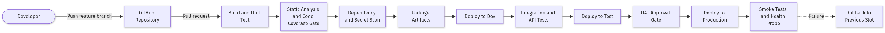
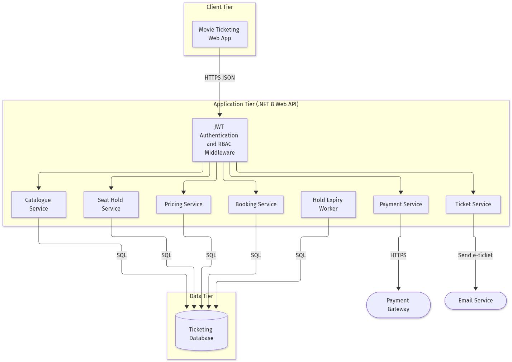
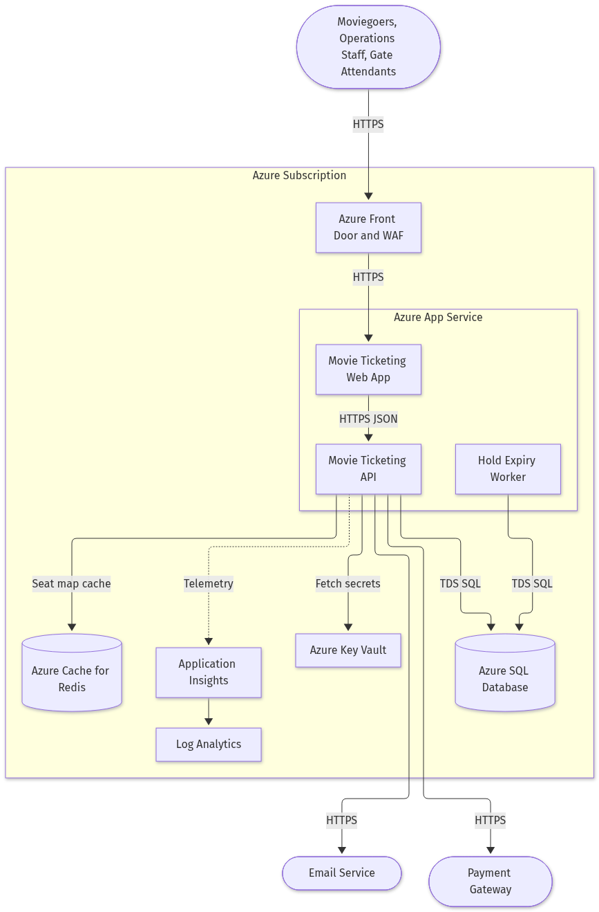
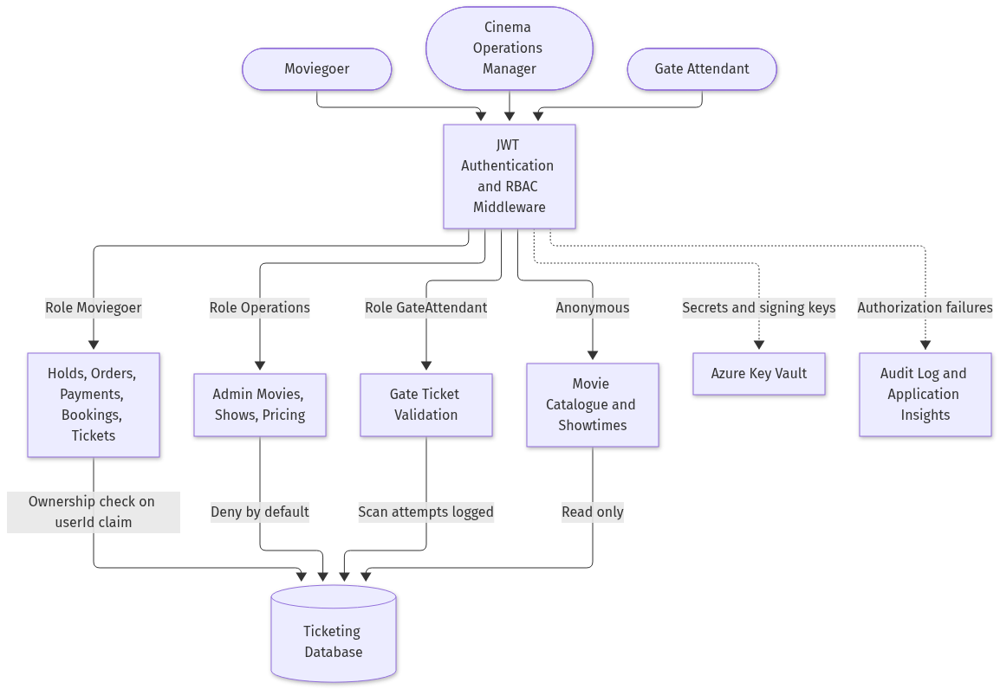
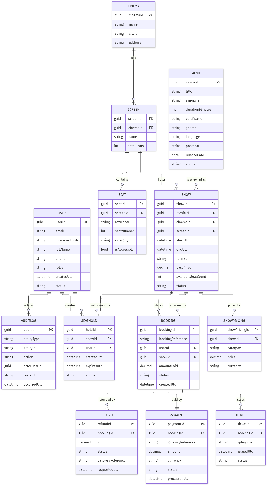

# **4. Technical Design Specification**

## **4.1 Integration Plan**

- Payment gateway integration uses two contracts: `POST /api/v1/payments/intent` (server-to-server intent creation returning a client secret consumed by gateway-hosted fields) and `POST /api/v1/payments/webhook` (inbound, HMAC signature verified, idempotent on `gatewayReference`); owner: Payments squad.
- Transactional email integration dispatches the e-ticket containing booking reference, movie, cinema, screen, showtime and seat labels to the account email address; dispatch failure is non-blocking and raises an alert after 3 consecutive failures; owner: Platform squad.
- Internal data contracts are JSON DTOs versioned under `/api/v1`: `OrderQuote { holdId, lineItems[], subtotal, convenienceFee, taxAmount, grandTotal, currency }`, `SeatHold { holdId, showId, seatIds[], userId, createdUtc, expiresUtc, status }`, `Booking { bookingId, bookingReference, userId, showId, seatIds[], amountPaid, status }`.
- Authentication for all internal calls is a JWT bearer token validated for issuer, audience, expiry and signature; gateway calls authenticate with an API key resolved at runtime from Azure Key Vault; webhook calls authenticate by signature only and never by IP allow-list alone.
- Measurable integration checkpoints: contract tests green for all 4 external operations, webhook replay test proving exactly-one Booking across 5 duplicate deliveries, signature-tampering test returning HTTP 401, and a 24-hour soak confirming zero orphaned `Active` holds after expiry processing.

## **4.2 Configuration Checklist**

- Platform settings: `SeatHold:DurationMinutes`, `Booking:MaxSeatsPerTransaction`, `Cancellation:CutOffHours`, `Cancellation:PenaltyPercent`, `Pricing:ConvenienceFeePercent`, `Pricing:TaxPercent` are all configuration-driven, none hard-coded; the cut-off and penalty values remain pending business confirmation on User Story 2703.
- Secrets in Azure Key Vault: `JwtSigningKey`, `PaymentGateway:ApiKey`, `PaymentGateway:WebhookSecret`, `Email:ApiKey`, `Sql:ConnectionString`; secrets are referenced only through managed identity and never committed to source control.
- Azure resources: App Service plan `asp-movieticketing-<env>`, web app `app-movieticketing-web-<env>`, API `app-movieticketing-api-<env>`, worker `app-movieticketing-worker-<env>`, `sql-movieticketing-<env>`, `redis-movieticketing-<env>`, `kv-movieticketing-<env>`, `appi-movieticketing-<env>`.
- Runtime versions pinned: .NET 8 LTS, React 18, Node 20 build toolchain, Entity Framework Core 8, SQL compatibility level 160, container base image digest-pinned and patched monthly.
- Infrastructure is deployed as version-controlled Bicep modules with remote state and per-environment parameter files (`dev`, `test`, `prod`); no portal-only configuration is permitted, and drift is detected by a nightly what-if run.

## **4.3 Service Level Agreement**

- Availability target 99.9% monthly for the booking path (catalogue, seat map, hold, quote, payment, ticket), measured by synthetic transactions every 60 seconds.
- Latency targets: seat-map read p95 at or below 500 ms, hold creation p95 at or below 400 ms, order quote p95 at or below 300 ms, ticket validation p95 at or below 300 ms at the gate, all measured server-side excluding gateway time.
- Recovery objectives: RTO 1 hour and RPO 5 minutes, supported by point-in-time restore on the SQL database and geo-redundant backups retained for 35 days.
- Maintenance window Tuesdays 02:00-04:00 UTC, with zero-downtime slot swaps required for any release touching the booking path during peak release windows (Friday to Sunday).
- Escalation SLAs: Sev-1 (seats double-sold, payments failing, gate validation down) acknowledged within 15 minutes and mitigated within 4 hours; Sev-2 within 1 hour and 1 business day; Sev-3 next business day.

## **4.4 Security & Compliance Architecture**

- Network segmentation: public traffic terminates at Azure Front Door with WAF managed rules; the API and worker sit behind private endpoints to SQL, Redis and Key Vault, with no public database exposure.
- Encryption standards: TLS 1.2 or higher in transit on every hop, AES-256 Transparent Data Encryption at rest, and salted password hashing only; plaintext passwords and password hashes are never returned by any endpoint.
- Key rotation: JWT signing keys rotated every 90 days with overlapping validity, gateway and email API keys rotated every 180 days, all rotations automated through Key Vault with versioned references.
- Compliance mapping: PCI-DSS SAQ-A scope is achieved because card data is captured exclusively in gateway-hosted fields; GDPR obligations are met through purpose-limited retention of personal data and audit evidence of access; audit records are immutable and exportable.
- Policy enforcement: deny-by-default authorization on every admin and gate endpoint, ownership checks against the `userId` claim for all customer resources, HTTP 403 plus a logged authorization-failure event on violation, and secret-scanning plus dependency-scanning gates in CI.

## **4.5 Workflow, Orchestration & Scheduling**

- Booking workflow steps: select seats, create hold (transactional, unique-constrained), quote order, create payment intent, gateway settlement, signed webhook, confirm booking, generate ticket, dispatch e-ticket email.
- Orchestration is in-process within the .NET 8 API using scoped transactions; no external workflow engine is introduced, which keeps the seat-uniqueness guarantee inside one commit boundary.
- Hold-expiry scheduling: hosted background service executes every 30 seconds, processes holds in batches of 200, and is idempotent so that overlapping executions cannot double-release a hold.
- Retries and backoff: 3 attempts with exponential backoff and jitter for gateway and email calls; webhook processing itself is never retried destructively because it is idempotent on `gatewayReference`.
- Failure-handling paths: per-hold try/catch so a single failure never aborts the batch; failed refunds persist with status `Failed` for operator follow-up; every failure is logged with a correlation ID that ties frontend, API, worker and gateway records together.

## **4.6 Release Management & Environment Strategy**

- Pipelines: GitHub Actions workflows for build-and-test, container publish, and environment deploy, each triggered on pull request, merge to `main`, and tagged release respectively.
- Branching strategy: trunk-based development on `main` with short-lived `feature/*` branches, mandatory pull-request review, and no direct pushes to `main`.
- Environment promotion: `dev` on every merge, `test` on a green integration suite, `prod` only after UAT approval; the same immutable container digest is promoted across all three environments.
- Artifact versioning: semantic versioning `MAJOR.MINOR.PATCH` with the Git short SHA appended to the container tag, and database migrations versioned and applied forward-only.
- Rollback: production deploys use App Service staging slots with swap; rollback is a reverse swap targeted at under 5 minutes, and any migration that is not backward compatible must ship behind a feature flag.

## **4.7 Testing Strategy & Quality Gates**

- Testing stages: unit, integration (API plus database), contract tests against a gateway sandbox, end-to-end UI journeys, concurrency tests, and accessibility checks on the seat map.
- Automation coverage thresholds: minimum 80% line coverage overall and 90% on SeatHoldService, PricingService, PaymentService and TicketService; the build fails below threshold.
- Concurrency gate: an automated test firing 50 simultaneous hold requests for the same seat must produce exactly one HTTP 201 and 49 HTTP 409 responses before any release to `test`.
- Defect severity rules: no open Sev-1 or Sev-2 defects may be promoted to production; Sev-3 defects require a documented workaround and a scheduled fix sprint.
- Performance benchmarks: load test sustaining 500 concurrent seat-map users and 100 bookings per minute while holding p95 latency within the Section 4.3 targets and zero double-sold seats.

*Caption: The CI/CD pipeline enforces the quality and security gates described above between every environment promotion.*

# **5. Implementation Plan**

## **5.1 Phased Rollout Strategy**

- Week 1-2: Provision `dev` infrastructure via Bicep (App Service, SQL, Redis, Key Vault, Application Insights), scaffold the .NET 8 solution and the React 18 app, and establish the CI pipeline with coverage and secret-scanning gates. Advancement criterion: a health-probe deployment succeeds end to end.
- Week 3-4: Implement the data model and Feature 2688 (movie discovery and showtime browsing) including the public read endpoints. Advancement criterion: anonymous catalogue and showtime browsing passes all acceptance criteria of Stories 2689, 2690 and 2691.
- Week 5-6: Implement Feature 2700 identity (registration, login, refresh, RBAC middleware). Advancement criterion: protected routes reject expired tokens with HTTP 401 and the refresh flow succeeds.
- Week 7-9: Implement Feature 2692 (seat map, hold creation, hold-expiry worker). Advancement criterion: the 50-concurrent-request seat test yields exactly one success, and zero orphaned holds remain after a 24-hour soak.
- Week 10-12: Implement Feature 2696 (quote, payment intent, signed webhook, booking confirmation, QR ticket). Advancement criterion: duplicate webhook delivery creates exactly one Booking and signature tampering returns HTTP 401.
- Week 13-14: Implement Feature 2700 booking history and cancellation with refund initiation. Advancement criterion: cancellation outside the configured cut-off returns HTTP 422 and seats are returned to sale inside it.
- Week 15-16: Implement Feature 2704 (admin catalogue, show scheduling with overlap detection, seat-category pricing, gate validation). Advancement criterion: overlapping schedule returns HTTP 409 and a used ticket rescans as `already-used`.
- Week 17: Deploy to `test`, run the full regression, load and accessibility suites. Advancement criterion: all Section 4.7 gates green.
- Week 18: UAT with cinema operations and gate staff, security design review sign-off, and penetration test remediation. Advancement criterion: no open Sev-1 or Sev-2 defects.
- Week 19-20: Pilot production release to a single cinema using slot-swap deployment, monitor for one full weekend cycle, then roll out to all cinemas. Advancement criterion: zero double-sold seats and availability within the 99.9% target during the pilot.

## **5.2 Teams and Security Roles**

- Product Owner owns the backlog of Epic 2687 and signs off the open cancellation cut-off and penalty decision before Week 13.
- Solution Architect owns this document, the ADRs and the API contract review gate; approval is required before backend implementation of each feature.
- Frontend squad owns the React 18 application, seat-map accessibility and token handling; it has `Contributor` scope on the web app resource in `dev` only.
- Backend squad owns the .NET 8 API, the hold-expiry worker and database migrations; it has `Contributor` scope in `dev` and `test`, and read-only in `prod`.
- Platform/DevOps engineer owns Bicep modules, pipelines, slots and Key Vault access policies; it is the only role with deployment rights to `prod`, exercised through pipeline identity rather than interactive access.
- Security engineer owns the threat model, dependency and secret scanning gates, key rotation schedule and the pre-production security review sign-off.
- QA lead owns the regression, concurrency, load and accessibility suites and holds the authority to block promotion on any failed quality gate.
- Application roles in production are Moviegoer (own bookings and tickets only), CinemaOperationsManager (catalogue, scheduling, pricing), GateAttendant (ticket validation only) and SupportOperator (read-only booking lookup plus refund follow-up).
- Escalation path: on-call engineer, then backend squad lead, then Solution Architect, then Product Owner, with Sev-1 paging the on-call engineer within 15 minutes.
- Access reviews of all production role assignments and Key Vault policies are performed quarterly and evidenced in the audit log.

# **6. Effort & Schedule Estimation**

## **6.1 Estimation Approach**

Estimation combines story points on a Fibonacci scale assigned during backlog refinement, T-shirt sizing at feature level for early capacity planning, and three-point (Optimistic/Realistic/Pessimistic) estimates for the two highest-risk areas. Feature sizing: Movie Discovery (M, 13 points), Seat Selection and Seat-Hold (L, 26 points), Checkout and Payment (L, 29 points), Customer Account and Cancellation (M, 18 points), Cinema Operations and Gate Validation (M, 21 points), giving 107 points in total. Three-point estimates: seat-hold concurrency 2.5 / 3.0 / 4.5 weeks and payment-gateway integration 2.5 / 3.0 / 5.0 weeks, producing PERT expectations of approximately 3.2 and 3.3 weeks respectively. A velocity of 12 points per two-week sprint for one cross-functional squad underpins the 20-week schedule, with a 15% contingency reserve held against gateway sandbox availability.

## **6.2 Timeline & Milestones**

- M1 Foundations ready: Week 1 to Week 2; no upstream dependency; on the critical path because every later milestone deploys through this pipeline.
- M2 Discovery and identity complete: Week 3 to Week 6; depends on M1; partially parallelisable between frontend and backend.
- M3 Seat-hold concurrency proven: Week 7 to Week 9; depends on M2; firmly on the critical path as the booking flow cannot be built on an unproven hold mechanism.
- M4 Payment and e-ticket complete: Week 10 to Week 12; depends on M3 and on payment-gateway sandbox credentials; on the critical path with the highest external dependency risk.
- M5 Operations, UAT and production pilot: Week 13 to Week 20; depends on M4 and on the business decision regarding the cancellation cut-off and penalty; the critical path runs M1, M3, M4, M5.

# **7. Assumptions & Dependencies**

## **7.1 Assumptions**

- The cancellation cut-off period and cancellation penalty percentage are unresolved on User Story 2703 and are implemented as configurable settings; business confirmation is required before Week 13.
- Seat-hold duration and the maximum number of seats per transaction are configurable platform settings because no numeric values were supplied in the requirements.
- A single relational database provides the transactional boundary for seat uniqueness; horizontal scaling is achieved by scaling the stateless API tier rather than sharding the booking store.
- The payment gateway supports hosted payment fields, idempotent signed webhooks and server-initiated refunds; this keeps the platform in PCI-DSS SAQ-A scope.
- Availability and latency targets in Section 4.3 are architecture assumptions derived from a typical consumer booking workload and require business confirmation.
- Azure App Service is the hosting target consistent with the baseline technology stack; no on-premises deployment is planned.

## **7.2 External Dependencies**

- Payment gateway vendor: sandbox and production credentials, webhook signing secret, and a documented refund API, required by Week 10.
- Transactional email provider: verified sending domain, SPF/DKIM records and API key, required by Week 11.
- Azure platform team: subscription, resource group, managed identities and network policy approval, required by Week 1.
- Cinema operations business owners: confirmed cancellation cut-off, penalty percentage, seat categories and convenience-fee and tax rates, required by Week 13.
- Security and compliance function: threat-model review and penetration-test slot booked for Week 18.

# **8. Appendices**

## **8.1 Additional Diagrams**

- !High-Level Flow

*Caption: Logical component flow for Epic 2687 from the React client through the RBAC boundary to the transactional data store.*

- !Deployment Diagram

*Caption: Azure deployment topology covering Front Door and WAF, App Service hosted web, API and expiry worker, Azure SQL, Redis cache, Key Vault and Application Insights with Log Analytics.*

- !CI/CD Pipeline

*Caption: Build, scan, package and promote pipeline with the UAT approval gate and the slot-swap rollback path that protects the booking flow in production.*

- !Security and RBAC

*Caption: Role-to-endpoint authorization map for Moviegoer, Cinema Operations Manager and Gate Attendant, including anonymous catalogue access and ownership enforcement.*

- !Data Model

*Caption: Entity-relationship model covering User, Movie, Cinema, Screen, Show, ShowPricing, Seat, SeatHold, Booking, Payment, Ticket, Refund and AuditLog.*

**Fallback**: All Mermaid sources are version-controlled alongside the rendered PNG files in `docs/architecture/epic-2687/` and can be re-rendered if any image is unavailable.
